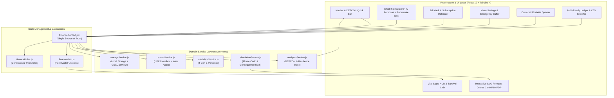

<div align="center">

# ⚡ PULSE // OS
### Enterprise-Grade Gen Z ₹10,000 / 30-Day Financial Survival & Pre-Decision Simulator

[](https://react.dev/)
[](https://tailwindcss.com/)
[](https://vitejs.dev/)
[](https://vitest.dev/)
[](https://oxc.rs/)
[](https://www.w3.org/WAI/standards-guidelines/wcag/)
[](SECURITY.md)
[](LICENSE)

<p align="center">
  <b>A consumer-grade, mathematically verified personal finance operating system engineered specifically for Gen Z navigating an unforgiving ₹10,000 monthly allowance over 30 days.</b><br>
  <i>PULSE breaks away from passive retrospective bookkeeping by delivering an active <b>Pre-Decision Sandbox</b> with Monte Carlo fan projections, a 5-tier DEFCON austerity engine, 4 distinct AI personality archetypes, hardware Indian UPI Soundbox voice synthesis, and real-time consequence matrices.</i>
</p>

[Explore Live Demo](http://localhost:5173/) • [Architecture Blueprint](ARCHITECTURE.md) • [Changelog](CHANGELOG.md) • [Contributing](CONTRIBUTING.md) • [Security Policy](SECURITY.md)

---

</div>

## 📑 Table of Contents

- [⚡ Executive Problem & Solution Hypothesis](#-executive-problem--solution-hypothesis)
- [🌟 Centerpiece Innovations (v1.1.0)](#-centerpiece-innovations-v110)
  - [1. FinPulse Neural AI Copilot (4 Switchable Gen Z Personas)](#1-finpulse-neural-ai-copilot-4-switchable-gen-z-personas)
  - [2. Indian UPI Soundbox Voice & Melodic Synthesizer](#2-indian-upi-soundbox-voice--melodic-synthesizer)
  - [3. DEFCON Financial Austerity Matrix & Spend Freeze Lockdown](#3-defcon-financial-austerity-matrix--spend-freeze-lockdown)
  - [4. Multi-Party Roommate & Group Cost Splitter](#4-multi-party-roommate--group-cost-splitter)
  - [5. 350-Iteration Monte Carlo 30-Day Fan Projections (P10/P50/P90)](#5-350-iteration-monte-carlo-30-day-fan-projections-p10p50p90)
  - [6. Micro-Savings Vaults & Emergency Buffer Shield](#6-micro-savings-vaults--emergency-buffer-shield)
  - [7. Complete Data Sovereignty & Portability (CSV + JSON)](#7-complete-data-sovereignty--portability-csv--json)
- [🧮 Mathematical Formulation & Pure Calculation Engine](#-mathematical-formulation--pure-calculation-engine)
  - [1. Liquid Cash Balance](#1-liquid-cash-balance)
  - [2. True Free Cash Flow](#2-true-free-cash-flow)
  - [3. Safe Daily Allowance ("Safe to Spend Today")](#3-safe-daily-allowance-safe-to-spend-today)
  - [4. Dynamic Financial Risk Score ($5\% - 99\%$)](#4-dynamic-financial-risk-score-5---99)
  - [5. Composite Financial Health Score ($10 - 98$)](#5-composite-financial-health-score-10---98)
  - [6. DEFCON Severity Index ($1 - 5$)](#6-defcon-severity-index-1---5)
  - [7. Monte Carlo Variance & Confidence Band Polygon](#7-monte-carlo-variance--confidence-band-polygon)
- [🏗️ Enterprise System Architecture](#️-enterprise-system-architecture)
- [🎨 Design System & Visual Tokens](#-design-system--visual-tokens)
- [⚡ Performance Optimization & Containment](#-performance-optimization--containment)
- [♿ Accessibility (WCAG 2.1 AAA Compliance)](#-accessibility-wcag-21-aaa-compliance)
- [🧪 Automated Verification Suite (Vitest + Oxlint)](#-automated-verification-suite-vitest--oxlint)
- [🚀 Quick Start & Installation](#-quick-start--installation)
- [📂 Clean Project Hierarchy](#-clean-project-hierarchy)
- [📄 Governance, Security & Disclosures](#-governance-security--disclosures)

---

## ⚡ Executive Problem & Solution Hypothesis

Managing a tight **₹10,000 monthly allowance** across 30 days is a high-wire financial act for college students, interns, and young professionals in Indian tech hubs (Bengaluru, Pune, Gurugram, Mumbai).

### Why Traditional Personal Finance Apps Fail Gen Z:
1. **Passive Autopsy Accounting**: Traditional apps log money *after* it leaves the bank account. Warning a user that they went broke 10 days ago does not prevent insolvency.
2. **Cognitive Blind Spots**: Gen Z makes micro-spending decisions on UPI without calculating how a ₹460 midnight food delivery compresses their remaining 20-day allowance by -₹23 every single day.
3. **Guilt Without Alternatives**: Budgeting apps deliver sterile, shaming charts rather than pragmatic compromises, habit friction, or relatable coaching.

### How PULSE OS Solves This:
PULSE operates as an **Active Pre-Decision Simulator**. Before committing funds to a payment gateway or UPI app, users test their choice in the sandbox:
- **Instant Leeway Penalty**: Pre-calculates the exact daily allowance loss before purchase execution.
- **Goal Postponement Impact**: Quantifies the delayed timeline on dream purchases (e.g., concert tickets, sneakers).
- **Multi-Persona AI Coaching**: Evaluates impulse decisions with context-rich advice ranging from brutal roasts to quantified trade-offs.
- **Behavioral Delay (48-Hour Wishlist)**: Converts impulse cravings into celebrated financial wins with particle physics confetti.

---

## 🌟 Centerpiece Innovations (v1.1.0)

### 1. FinPulse Neural AI Copilot (4 Switchable Gen Z Personas)
A client-side dynamic reasoning engine in [`src/services/aiAdvisorService.js`](src/services/aiAdvisorService.js) that analyzes purchases against real-time liquidity and runway across 4 distinct Gen Z mindsets:
- 🔥 **Roast Master**: Witty, zero-filter reality checks that point out dopamine-driven spending habits.
- 🧘 **Zen Monk**: Calming mindfulness coaching that focuses on emotional regulation, intentionality, and 24-hour pauses.
- 🚀 **Hyper-Hustler**: Aggressive opportunity-cost calculus measuring expenses against future compounding and freelancing hours.
- 📈 **Quant Analyst**: Pure actuarial numbers, standard deviations, runway burn, and probability-of-ruin metrics.

### 2. Indian UPI Soundbox Voice & Melodic Synthesizer
A zero-dependency client audio synthesizer in [`src/services/soundService.js`](src/services/soundService.js) emulating the iconic Indian merchant Soundbox:
- **3-Note Melodic Carrier Chime**: Generates clean sine waves on C6 (1046.5 Hz) $\to$ E6 (1318.5 Hz) $\to$ G6 (1567.98 Hz) with linear exponential decay via the Web Audio API.
- **Natural Spoken Confirmation**: Uses the browser's native `SpeechSynthesisUtterance` to speak: *"Rupees [Amount] debited on FinPulse"*.
- **Zero External Assets**: Operates with zero network requests or audio file downloads, ensuring complete offline availability.

### 3. DEFCON Financial Austerity Matrix & Spend Freeze Lockdown
A systemic defense protocol modeled after defense readiness conditions:
- **DEFCON 5 (Normal)**: Safe Daily Spend $> ₹250$ — Smooth sailing.
- **DEFCON 4 (Guarded)**: Safe Daily Spend $₹180 - ₹250$ — Mild caution.
- **DEFCON 3 (Elevated)**: Safe Daily Spend $₹120 - ₹180$ — Non-essential spending warned.
- **DEFCON 2 (High)**: Safe Daily Spend $₹60 - ₹120$ — Discretionary spending discouraged.
- **DEFCON 1 (Emergency)**: Safe Daily Spend $< ₹60$ or Free Cash $\le 0$ — Severe insolvency risk.
- **Interactive Spend Freeze Lockdown**: A single toggle in the HUD halts all discretionary purchases, displays an omnipresent amber/rose banner, and activates immediate financial recovery mode.

### 4. Multi-Party Roommate & Group Cost Splitter
An integrated group spending simulator:
- Supports Solo, 2-way, 3-way, 4-way, and 5-way bill splitting directly in the Decision Simulator.
- Recalculates consequence matrices based on the user's actual per-person share rather than the total bill.
- Prevents group dining and road trip splurges from distorting solo budget metrics.

### 5. 350-Iteration Monte Carlo 30-Day Fan Projections (P10/P50/P90)
Located in [`src/services/simulationService.js`](src/services/simulationService.js), this engine models 350 randomized financial futures factoring in daily volatility ($\sigma = 0.22$) and sudden curveball probabilities:
- **P90 (Optimistic Path)**: Frugal baseline, zero unexpected shocks.
- **P50 (Median Glidepath)**: Expected real-world trajectory.
- **P10 (Stress Test Path)**: Multiple concurrent curveballs and high discretionary burn.
- **Interactive SVG Shaded Polygon**: Visualizes the confidence envelope alongside the 30-day timeline with an exact Solvency Probability Index ($P(\text{Solvency} \ge 0)$).

### 6. Micro-Savings Vaults & Emergency Buffer Shield
Ringfenced vaults isolate locked savings from the liquid spending balance:
- Dream goals (e.g., Goa Trip, Noise ANC Headphones) feature dedicated progress meters.
- The Emergency Buffer provides automatic risk score relief (-12% risk) once reserves cross ₹1,200.

### 7. Complete Data Sovereignty & Portability (CSV + JSON)
Built in [`src/services/storageService.js`](src/services/storageService.js) to guarantee 100% user data ownership:
- **Local-First Client Storage**: Plain browser LocalStorage with zero telemetry, zero analytics tracking, and zero remote database leaks.
- **1-Click Full State JSON Backup**: Export and restore full simulation state with schema validation.
- **Audit-Ready CSV Export**: Export complete transaction ledgers for Excel, Google Sheets, or personal accounting tools.

---

## 🧮 Mathematical Formulation & Pure Calculation Engine

All core financial calculations are implemented as pure, deterministic functions in [`src/utils/financeMath.js`](src/utils/financeMath.js) and [`src/services/simulationService.js`](src/services/simulationService.js).

### 1. Liquid Cash Balance
$$\text{Liquid Balance} = \sum \text{Incomes} - \sum \text{Expenses} - \sum \text{Locked Savings}$$
*Locked savings are quarantined immediately to safeguard goal progression.*

### 2. True Free Cash Flow
$$\text{True Free Cash} = \text{Liquid Balance} - \left( \sum_{d \ge \text{today}} \text{Unpaid Commitments}_d + \sum_{d \ge \text{today}} \text{Active Subscriptions}_d \right)$$

### 3. Safe Daily Allowance ("Safe to Spend Today")
$$\text{Safe Daily Spend} = \max\left(0, \left\lfloor \frac{\text{True Free Cash}}{\max(1, 30 - \text{Current Day} + 1)} \right\rfloor\right)$$
*When True Free Cash $\le 0$, allowance clamps to ₹0/day to prevent mathematical negative debt distortion.*

### 4. Dynamic Financial Risk Score ($5\% - 99\%$)
$$R = R_{\text{base}} + \Delta R_{\text{liability}} + \Delta R_{\text{allowance}} + \Delta R_{\text{runway}} - \Delta R_{\text{emergency}}$$

Where:
- $\Delta R_{\text{liability}} = +35\%$ if liabilities $> 80\%$ of cash; $+22\%$ if $> 50\%$.
- $\Delta R_{\text{allowance}} = +30\%$ if Safe Daily Spend $< ₹100$; $+18\%$ if $< ₹180$.
- $\Delta R_{\text{runway}} = \min(25, (\text{Days Left} - \text{Runway Days}) \times 3)$ when burn rate exceeds timeline.
- $\Delta R_{\text{emergency}} = -12\%$ if Emergency Buffer $\ge ₹1,200$; $+15\%$ if $< ₹500$.

### 5. Composite Financial Health Score ($10 - 98$)
$$H = 100 - (0.65 \times R) + \left( 20 \times \frac{\text{Locked Savings}}{\text{Target Savings}} \right) - \text{Penalties}$$
- **Zen Master** ($\ge 82$): Resilient emergency cushion, disciplined burn rate.
- **Smart Hustler** ($68 - 81$): Solid balance with minor trade-offs.
- **Tightrope Walker** ($50 - 67$): Vulnerable to unplanned shocks.
- **Code Red Survivor** ($< 50$): High risk of insolvency before Day 30.

### 6. DEFCON Severity Index ($1 - 5$)
The tactical austerity protocol dynamically evaluates liquidity, impending liabilities, allowance squeeze, and overall financial risk:
$$\text{DEFCON} = \begin{cases} 
1 & \text{if } \text{True Free Cash} \le 0 \lor \text{Liquid Balance} \le 0 \\
2 & \text{if } \frac{\text{Liabilities}}{\text{Liquid}} > 0.50 \lor \text{Risk} \ge 75 \\
3 & \text{if } \text{Safe Daily} < 150 \lor \text{Risk} \ge 52 \\
4 & \text{if } \frac{\text{Liabilities}}{\text{Liquid}} > 0.30 \lor \text{Risk} \ge 28 \\
5 & \text{otherwise (Normal Peacetime Operations)}
\end{cases}$$

### 7. Monte Carlo Variance & Confidence Band Polygon
Configured via `MONTE_CARLO_CONFIG` ($K = 350$ trials, $V \in [0.80, 1.25]$ daily spend factor, $\sigma = 0.22$, shock probability $p = 0.08$ with cost $[₹150, ₹600]$):
$$\text{DayPace}_k = \max(80, \text{SafeDaily}) \cdot (0.80 + \text{rand} \cdot 0.45)$$
$$\text{Shock}_{k, t} \sim \text{Bernoulli}(p = 0.08) \cdot (150 + \text{rand} \cdot 450)$$
$$B_{k, t} = B_{k, t-1} - \text{DayPace}_k - \text{Shock}_{k, t}$$
$$\text{EndingBalance}_k = B_{k, 30} - \text{PendingLiabilities}$$
$$\text{Band}(t) = \left[ P_{10}(B_{\cdot, t}), P_{50}(B_{\cdot, t}), P_{90}(B_{\cdot, t}) \right]$$
$$\text{SurvivalRate} = \frac{1}{K} \sum_{k=1}^{K} \mathbb{I}(\text{EndingBalance}_k \ge 0) \times 100\%$$

---

## 🏗️ Enterprise System Architecture



---

## 🎨 Design System & Visual Tokens

PULSE features a customized dark-mode aesthetic inspired by Revolut Ultra, Linear, and modern fintech hardware.

| Token | Hex / CSS Value | Design Purpose |
| :--- | :--- | :--- |
| **Canvas Background** | `#05060b` (`--color-canvas`, `--bg-base`) | Deep near-black obsidian canvas |
| **Surface Scale** | `#070a12` (inset), `#0b0f1a` (surface), `#0d1120` (surface-2), `#121728` (elevated) | 4-tier hierarchical surface elevation |
| **Glass Surface** | `rgba(11, 15, 26, 0.66)` (`--bg-glass`) | Frosted glassmorphism with 16px blur & specular border |
| **Aurora Violet** | `#8b5cf6` (top `#9061ff`, deep `#7c3aed`) | Primary brand accent & active HUD highlight |
| **Aurora Teal** | `#2dd4bf` (`--aurora-teal`), `#14b8a6` (`--aurora-cyan-deep`) | Secondary brand accent, trajectories & savings rings |
| **Aurora Indigo** | `#6366f1` (`--aurora-indigo`) | Ancillary brand contrast highlight |
| **Status Emerald** | `#10b981` (`--status-emerald`) | Safe daily allowance, DEFCON 5 & savings milestones |
| **Status Amber** | `#f59e0b` (`--status-amber`) | DEFCON 3 caution & liability warnings |
| **Status Rose** | `#f43f5e` (`--status-rose`) | DEFCON 1-2 crisis, deficit redline & austerity freeze |

---

## ⚡ Performance Optimization & Containment

1. **Vite 8 Native Rolldown Bundler**: Produces highly optimized, tree-shaken chunks in **598ms**:
   - `vendor-react`: Core React 19 runtime.
   - `vendor-icons`: Lucide React icon suite.
   - `vendor-canvas`: Canvas Confetti animation library.
2. **Component Memoization**: Critical interactive widgets (`VitalSignsHUD`, `ForecastChart`, `DecisionSimulator`, `TransactionLedger`, `Navbar`) are wrapped in `React.memo` with stabilized callbacks.
3. **Hardware-Accelerated CSS Containment**:
   - `contain: paint` on charts and complex holographic cards.
   - `content-visibility: auto` with `contain-intrinsic-size: 0 450px` on heavy ledger tables.
   - Zero layout shifts during state transitions.
4. **Web Audio Oscillator Recycling**: Audio contexts are lazy-initialized on first user interaction and suspended cleanly to prevent battery drain.

---

## ♿ Accessibility (WCAG 2.1 AAA Compliance)

- **Semantic Landmarks**: Complete landmark coverage via `<header>`, `<nav role="tablist">`, `<main id="main-content">`, `<section>`, and `<footer>`.
- **Skip to Content Link**: Direct keyboard access to `#main-content` for screen reader and keyboard power users.
- **ARIA Live Regions**: Live status updates (`aria-live="polite"`) on financial metrics, DEFCON alerts, and simulator results.
- **Full Keyboard Navigation**: Every interactive element includes accessible focus rings (`focus-visible:ring-2 focus-visible:ring-violet-400 focus-visible:outline-none`) and responds to `Enter`, `Space`, and `Escape`.
- **Motion Reduction**: Comprehensive support for `@media (prefers-reduced-motion: reduce)` disabling all heavy transforms and particle physics.

---

## 🧪 Automated Verification Suite (Vitest + Oxlint)

The application maintains a zero-defect automated testing and static analysis pipeline:

```bash
# Run unit test suites
npm test

# Run Oxlint static analysis
npm run lint

# Build production bundle
npm run build
```

### Verification Results Summary:
- **Vitest Unit Tests**: **74 / 74 Passing Tests** across 7 test suites in ~750ms:
  - `src/utils/financeMath.test.js`: 39 tests (core math formulas, bounds clamping, status tiers, transaction totals).
  - `src/services/simulationService.test.js`: 5 tests (Monte Carlo P10/P50/P90, consequence matrix, roommate splits).
  - `src/services/aiAdvisorService.test.js`: 4 tests (4 Gen Z personas, severity grading, contextual roasts).
  - `src/services/analyticsService.test.js`: 11 tests (DEFCON classification, boundary pinning tests, resilience scoring, telemetry).
  - `src/services/soundService.test.js`: 3 tests (Web Audio synthesis, UPI Soundbox announcer, pitch bounds).
  - `src/services/storageService.test.js`: 5 tests (localStorage persistence, JSON backup validation, CSV export).
  - `src/constants/financeRules.test.js`: 7 tests (DEFCON tiers, AI archetypes, health score thresholds, Monte Carlo config).
- **Oxlint Static Code Quality**: **0 warnings, 0 errors** across 50 files.
- **Production Bundle**: Built in **~800ms** via Vite 8 Rolldown with zero errors.

---

## 🚀 Quick Start & Installation

### Prerequisites
- Node.js `v18.0.0` or higher
- npm `v9.0.0` or higher

### Steps

```bash
# 1. Clone repository
git clone https://github.com/shahdhairya12/6hourshackathon.git
cd 6hourshackathon

# 2. Install dependencies
npm install

# 3. Start local development server
npm run dev

# 4. Execute test suite
npm test

# 5. Run static lint check
npm run lint

# 6. Build optimized production bundle
npm run build

# 7. Preview production build
npm run preview
```

Open **`http://localhost:5173/`** in any modern web browser.

---

## 📂 Clean Project Hierarchy

```
6hourshackathon/
├── .github/
│   ├── ISSUE_TEMPLATE/
│   │   ├── bug_report.md
│   │   └── feature_request.md
│   └── pull_request_template.md
├── public/                     # Favicons, icons & web manifest
├── src/
│   ├── app/                    # App Shell & Error Boundary
│   │   ├── App.jsx             # Shell layout, tab routing & global modals
│   │   └── ErrorBoundary.jsx   # Fault-tolerant runtime exception boundary
│   ├── components/             # Reusable UI & Layout Primitives
│   │   ├── layout/             # Structural layout components (Navbar, Footer, Toast)
│   │   └── ui/                 # Atomic design system primitives (Card, Button, Badge, Modal, etc.)
│   ├── constants/              # Business Rules & Thresholds
│   │   ├── financeRules.js     # DEFCON thresholds, health tiers, Monte Carlo config
│   │   └── financeRules.test.js # Configuration invariant unit tests
│   ├── core/                   # State Management & Custom Hooks
│   │   ├── context/            # FinanceContext.jsx & financeContextInstance.js
│   │   └── hooks/              # useFinance.js & useLocalStorage.js
│   ├── data/                   # Immutable Seed Assets (initialData.js)
│   ├── features/               # Feature-Driven Product Domains
│   │   ├── commitments/        # CommitmentsManager.jsx (bills & subscriptions)
│   │   ├── curveball/          # CurveballRoulette.jsx (life events spinner)
│   │   ├── dashboard/          # OverviewDashboard.jsx & VitalSignsHUD.jsx
│   │   ├── forecast/           # ForecastChart.jsx (SVG curve & Monte Carlo fan)
│   │   ├── savings/            # SavingsVaults.jsx & WishlistVault.jsx
│   │   ├── simulator/          # DecisionSimulator.jsx (4 AI personas & split)
│   │   ├── transactions/       # TransactionLedger.jsx & AddTransactionModal.jsx
│   │   └── wrap/               # FinancialWrapModal.jsx (FinPulse Wrapped receipt)
│   ├── services/               # Domain Service Layer
│   │   ├── aiAdvisorService.js # 4 Gen Z persona AI copilot (+ test)
│   │   ├── analyticsService.js # DEFCON auditor & resilience indexer (+ test)
│   │   ├── simulationService.js # Monte Carlo fan & consequence matrix (+ test)
│   │   ├── soundService.js     # Web Audio synthesizer & UPI Soundbox (+ test)
│   │   └── storageService.js   # JSON backup/restore & CSV exporter (+ test)
│   ├── styles/                 # Aurora Obsidian Design System
│   │   ├── base.css            # Base typography & dot mesh background
│   │   ├── components.css      # Glassmorphic surfaces & button classes
│   │   ├── index.css           # Master stylesheet entry point
│   │   └── tokens.css          # Color tokens, radii, surfaces & CSS variables
│   ├── types/                  # Typed Contracts & Runtime Validation
│   │   ├── finance.d.ts        # TypeScript declarations
│   │   └── index.js            # Runtime schema validators
│   ├── utils/                  # Pure Business Logic & Math Engine
│   │   ├── audio.js            # Backward-compatible audio bridge
│   │   ├── financeMath.js      # Pure mathematical formulas & Monte Carlo engine
│   │   ├── financeMath.test.js # Unit test suite (39 tests)
│   │   └── performance.js      # CSS containment & web vitals telemetry
│   └── main.jsx                # React 19 bootstrap entry point
├── ARCHITECTURE.md             # Enterprise C4 blueprint & math formulations
├── CHANGELOG.md                # Semantic Keep a Changelog (v1.1.0 & v1.0.0)
├── CODE_OF_CONDUCT.md          # Contributor Covenant v2.1
├── CONTRIBUTING.md             # Developer guidelines & review standards
├── LICENSE                     # MIT License
├── package.json                # Project dependencies & scripts
├── README.md                   # Project overview & documentation
├── SECURITY.md                 # Vulnerability disclosures & local privacy SLA
└── vite.config.js              # Vite 8 & Rolldown configuration
```


---

## 📄 Governance, Security & Disclosures

- **Security & Vulnerability Reporting**: Detailed in [`SECURITY.md`](SECURITY.md).
- **Contribution Standards**: Detailed in [`CONTRIBUTING.md`](CONTRIBUTING.md).
- **Code of Conduct**: Detailed in [`CODE_OF_CONDUCT.md`](CODE_OF_CONDUCT.md).
- **Release History**: Detailed in [`CHANGELOG.md`](CHANGELOG.md).
- **Privacy Assurance**: All calculations execute client-side. Zero personal financial data is transmitted to external servers.

---

<div align="center">
  <b>⚡ PULSE OS — Engineered with precision for Gen Z financial resilience.</b><br>
  Built with React 19, Tailwind CSS v4, and Vite 8 Rolldown.
</div>
