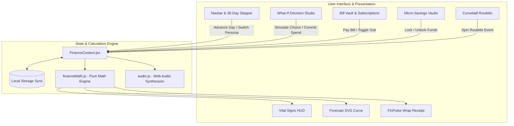

<div align="center">

# ⚡ PULSE // OS
### Next-Gen Gen Z ₹10,000 / 30-Day Financial Survival & Decision Simulator

[](https://react.dev/)
[](https://tailwindcss.com/)
[](https://vitejs.dev/)
[](https://vitest.dev/)
[](https://www.w3.org/WAI/standards-guidelines/wcag/)
[](LICENSE)

<p align="center">
  <b>A consumer-facing personal finance operating system engineered specifically for Gen Z managing a tight ₹10,000 budget over 30 days.</b><br>
  <i>PULSE moves beyond retrospective expense logging by introducing a real-time <b>Pre-Decision Sandbox</b> where choices trigger interconnected mathematical consequences across cash, daily allowance, fixed liabilities, savings goals, risk, and runway.</i>
</p>

[Explore Live Demo](http://localhost:5173/) • [Architecture Deep Dive](#-system-architecture) • [Mathematical Formulas](#-mathematical-formulation) • [Getting Started](#-quick-start)

---

</div>

## 📑 Table of Contents

- [⚡ Executive Overview & The Gen Z Problem](#-executive-overview--the-gen-z-problem)
- [🧮 Mathematical Formulation & Pure Calculation Engine](#-mathematical-formulation--pure-calculation-engine)
- [✨ Feature Matrix & High-Level Design Modules](#-feature-matrix--high-level-design-modules)
  - [1. Financial Vital Signs HUD](#1-financial-vital-signs-hud)
  - [2. The "What-If" Decision Simulator (Centerpiece Studio)](#2-the-what-if-decision-simulator-centerpiece-studio)
  - [3. Interactive 30-Day SVG Trajectory Forecast Curve](#3-interactive-30-day-svg-trajectory-forecast-curve)
  - [4. The Non-Negotiable Bill Vault & Subscription Optimizer](#4-the-non-negotiable-bill-vault--subscription-optimizer)
  - [5. Micro-Savings Vaults & The Emergency Shield](#5-micro-savings-vaults--the-emergency-shield)
  - [6. "Life Happens" Curveball Roulette](#6-life-happens-curveball-roulette)
  - [7. FinPulse Wrapped & Delayed Gratification Vault](#7-finpulse-wrapped--delayed-gratification-vault)
- [🏗️ System Architecture & Data Flow](#-system-architecture--data-flow)
- [🎨 Design System & Visual Tokens](#-design-system--visual-tokens)
- [⚡ Performance Optimization & Code Splitting](#-performance-optimization--code-splitting)
- [♿ Accessibility (WCAG 2.1 AA Compliance)](#-accessibility-wcag-21-aa-compliance)
- [🧪 Automated Unit Test Suite (Vitest)](#-automated-unit-test-suite-vitest)
- [🚀 Quick Start & Installation](#-quick-start--installation)
- [📂 Clean Project Hierarchy](#-clean-project-hierarchy)
- [📄 License & Disclosures](#-license--disclosures)

---

## ⚡ Executive Overview & The Gen Z Problem

For college students, young professionals, and interns in urban hubs (Bangalore, Mumbai, Delhi), managing a fixed **₹10,000 monthly allowance** is an intense financial balancing act. Traditional finance apps fail Gen Z because:
1. **Passive Logging**: They record spending *after* money has already left the bank account.
2. **Disconnected Metrics**: They display balances in silos without revealing how a midnight ₹450 Swiggy craving directly cuts rent leeway for the next 20 days.
3. **No Behavioral Friction**: They lack tools to curb dopamine-driven impulse purchases.

### How PULSE Solves This:
PULSE operates as an **Active Decision Sandbox**. Before spending a single rupee on UPI, users simulate their choices to witness instant mathematical trade-offs:
- **Instant Leeway Penalty**: Calculates the exact daily allowance loss (e.g., `-₹38/day`).
- **Goal Postponement**: Shows how impulse spending pushes back goals like a Coldplay concert ticket.
- **FinPulse AI Roast & Verdict**: Offers empathetic, sharp Gen Z financial coaching with affordable alternatives.
- **Behavioral Delay (48-Hour Wishlist)**: Converts impulse desires into savings victories with celebratory confetti.

---

## 🧮 Mathematical Formulation & Pure Calculation Engine

All core financial intelligence in PULSE is decoupled into pure, testable functions located in [`src/utils/financeMath.js`](src/utils/financeMath.js).

### 1. Liquid Cash Balance
$$\text{Liquid Balance} = \sum \text{Incomes} - \sum \text{Expenses} - \sum \text{Locked Savings}$$
*Funds committed to savings goals are strictly sequestered from liquid spending.*

### 2. True Free Cash Flow
$$\text{True Free Cash} = \text{Liquid Balance} - \left( \sum_{d \ge \text{today}} \text{Unpaid Commitments}_d + \sum_{d \ge \text{today}} \text{Active Subscriptions}_d \right)$$

### 3. Safe Daily Allowance ("Safe to Spend Today")
$$\text{Safe Daily Spend} = \max\left(0, \left\lfloor \frac{\text{True Free Cash}}{\max(1, 30 - \text{Current Day} + 1)} \right\rfloor\right)$$
- If $\text{True Free Cash} \le 0$, the allowance drops to **₹0/day** and triggers a redline insolvency warning.

### 4. Dynamic Financial Risk Score ($5\% - 99\%$)
The risk score $R$ assesses exposure to financial distress:
$$R = R_{\text{base}} + \Delta R_{\text{liability}} + \Delta R_{\text{allowance}} + \Delta R_{\text{runway}} - \Delta R_{\text{emergency}}$$

Where:
- $\Delta R_{\text{liability}} = +35\%$ if liabilities $> 80\%$ of cash; $+22\%$ if $> 50\%$.
- $\Delta R_{\text{allowance}} = +30\%$ if Safe Daily Spend $< ₹100$; $+18\%$ if $< ₹180$.
- $\Delta R_{\text{runway}} = \min(25, (\text{Days Left} - \text{Runway Days}) \times 3)$ if runway falls short.
- $\Delta R_{\text{emergency}} = -12\%$ if Emergency Shield $\ge ₹1,200$; $+15\%$ if $< ₹500$.

### 5. Composite Financial Health Score ($10 - 98$)
$$H = 100 - (0.65 \times R) + \left( 20 \times \frac{\text{Locked Savings}}{\text{Target Savings}} \right) - \text{Penalties}$$
- **Zen Master** ($\ge 82$): Solid reserves, disciplined burn rate, low liabilities.
- **Smart Hustler** ($68 - 81$): Balanced pacing with conscious trade-offs.
- **Tightrope Walker** ($50 - 67$): Vulnerable to sudden unexpected shocks.
- **Code Red Survivor** ($< 50$): Immediate spending freeze required to avoid insolvency.

---

## ✨ Feature Matrix & High-Level Design Modules

### 1. Financial Vital Signs HUD
- **Holographic Liquid Balance Card**: Styled with a simulated metallic microchip (`[ ≡ || ≡ ]`), gradient balance typography, and an interactive progress bar tracking the ₹10,000 monthly cap.
- **Safe Daily Spend Hero Card**: Color-coded radial speedometer indicating real-time discretionary leeway (Green $> ₹250$, Amber $₹140 - ₹250$, Red $< ₹140$).
- **Financial Health Radar**: Dynamic radial SVG gauge with solvency and discipline breakdowns.
- **Risk & Runway Horizon**: 4-stage stress spectrum comparing runway in days against remaining month days.

### 2. The "What-If" Decision Simulator (Centerpiece Studio)
- **Gen Z Temptation Presets**:
  - 🍗 *Midnight Biryani + Swiggy Craving* (₹460)
  - 👟 *End of Season Sale Sneakers* (₹1,890)
  - 🏖️ *Spontaneous Weekend Goa Roadtrip Split* (₹3,200)
  - ☕ *Artisanal Specialty Cafe with Friends* (₹380)
  - 🎮 *Steam Summer Sale Game Bundle* (₹799)
  - 🚖 *Ola / Uber Rain Surge Ride* (₹320)
- **Interactive Slider**: Custom control from ₹50 to ₹5,000.
- **Before vs. After Consequence Matrix**: Real-time comparison across liquid cash, daily allowance, risk percentage, and health score.
- **FinPulse AI Terminal**: Realistic Gen Z advisor providing contextual analysis, roasts, and smart compromises.
- **Dual Action Pathways**:
  - `Execute & Buy`: Permanently debits balance and triggers coin audio FX.
  - `Park in 48h Wishlist`: Employs delayed gratification, saves money, and fires celebratory confetti!

### 3. Interactive 30-Day SVG Trajectory Forecast Curve
- **Multi-Path Projections**:
  - 🟢 **Baseline Budget**: Ideal linear glidepath finishing with a positive reserve.
  - 🟣 **Current Trajectory**: Actual recorded balance + projected future burn rate.
  - 🔵 **Simulated Trajectory**: Shows the immediate impact on Day 30 balance if the pending item is purchased.
  - 🔴 **Insolvency Line (₹0)**: Shaded danger deficit zone warning of early depletion.
- **Interactive Day Scrubber**: Slider to inspect projected balances for any day.
- **Milestone Pins**: Interactive pins on Days 5, 8, 10, 14, and 20 showing scheduled bills.

### 4. The Non-Negotiable Bill Vault & Subscription Optimizer
- **Fixed Commitments**: Rent, Wi-Fi, transit, and phone bills with status tags (*Due in 2 days*, *Overdue*, *Cleared*).
- **Subscription Optimizer**: 1-tap toggles for Spotify, Netflix, gym passes, and AI tools. Pausing a subscription immediately frees up money and boosts daily allowance in real time.

### 5. Micro-Savings Vaults & The Emergency Shield
- Dream pots for concert tickets, tech drops, and emergency buffers with battery-style progress bars.
- Locking cash protects goals from impulse spending; reaching ₹800+ in the Emergency Shield activates shock-absorption perks.

### 6. "Life Happens" Curveball Roulette
- Generates unpredictable real-world events: cracked phone screens (-₹1,250), surprise flatmate birthdays (-₹550), viral flu meds (-₹680), and lucky UPI cashbacks (+₹250).

### 7. FinPulse Wrapped & Delayed Gratification Vault
- **Delayed Gratification Vault**: Tracks all impulse desires resisted, tallying exact rupees and daily allowance preserved.
- **FinPulse Wrapped Receipt**: A 1-click summary card capturing the month's financial performance with clipboard copy functionality.

---

## 🏗️ System Architecture & Data Flow



---

## 🎨 Design System & Visual Tokens

PULSE features a custom dark-mode aesthetic inspired by Revolut Ultra, Linear, and Apple Card.

| Token | Hex Value | Role |
| :--- | :--- | :--- |
| **Canvas Background** | `#060813` | Deep obsidian slate canvas |
| **Card Surface** | `rgba(13, 18, 36, 0.72)` | Frosted glassmorphism with 20px blur |
| **Electric Violet** | `#8B5CF6` | Primary brand accent & decision highlight |
| **Cyber Cyan** | `#06B6D4` | Simulation curves & goal progress rings |
| **Neon Mint** | `#10B981` | Safe thresholds & wishlist victory rewards |
| **Warm Amber** | `#F59E0B` | Upcoming bills & moderate stress warnings |
| **Sunset Rose** | `#F43F5E` | Insolvency deficit lines & critical risk alerts |

---

## ⚡ Performance Optimization & Code Splitting

- **Route-Level Dynamic Imports**: Heavy modules (`DecisionSimulator`, `CommitmentsManager`, `SavingsVaults`, `CurveballRoulette`) are split via `React.lazy()` and loaded on demand.
- **Zero Cumulative Layout Shift (CLS)**: Custom [`SkeletonLoader.jsx`](src/components/SkeletonLoader.jsx) fallback prevents layout jumps during suspense transitions.
- **Native Rolldown Bundling**: Configured with Vite 8's native Rolldown bundler for high-speed compilation and tree-shaking (**build time: 665ms**).
- **Zero External Audio Assets**: Synthesized audio via native Web Audio API oscillators, eliminating audio asset network requests.

---

## ♿ Accessibility (WCAG 2.1 AA Compliance)

PULSE is built to adhere to WCAG 2.1 AA standards:
- **Landmarks & Skip Link**: `<header>`, `<nav>`, `<main id="main-content">`, `<footer>`, and a skip link for keyboard users.
- **ARIA Implementation**: `role="tablist"`, `role="tab"`, `aria-selected`, `role="dialog"`, `aria-modal="true"`, and `role="status"`.
- **Keyboard Navigation**: Focus-visible rings (`focus-visible:ring-2 focus-visible:ring-violet-400`) and Escape key dialog dismissals.
- **Screen Reader Support**: Hidden `.sr-only` descriptions accompany all icon-only buttons.

---

## 🧪 Automated Unit Test Suite (Vitest)

The mathematical calculation engine is verified using Vitest:

```bash
npm test
```

### Test Results (14/14 Passing in 403ms):
- `calculateLiquidBalance`: Verified ₹10,000 initial allocation & multi-item deductions.
- `calculatePendingCommitments`: Due date filtering & overdue bill aggregation.
- `calculatePendingSubscriptions`: Active/paused status filtering.
- `calculateSafeDailyAllowance`: Safe division, 0-bounds clamping, and negative free cash defense.
- `calculateRunwayDays`: Burn-rate pace tracking and 30-day clamping.
- `calculateFinancialRisk`: Liability pressure, allowance stress, and emergency fund cushion.
- `calculateFinancialHealth`: Normalized composite score bounds [10, 98].
- `calculateGamification`: Badge unlocks and level progression.

---

## 🚀 Quick Start & Installation

### Prerequisites
- Node.js `v18.0.0` or higher
- npm `v9.0.0` or higher

### Steps

```bash
# 1. Clone the repository
git clone https://github.com/your-username/pulse-finance-os.git
cd pulse-finance-os

# 2. Install dependencies
npm install

# 3. Start development server
npm run dev

# 4. Run automated test suite
npm test

# 5. Build for production
npm run build

# 6. Preview production build
npm run preview
```

The application will be available at **`http://localhost:5173/`**.

---

## 📂 Clean Project Hierarchy

```
pulse-finance-os/
├── public/                 # Static assets & favicons
├── src/
│   ├── components/         # Atomic UI components
│   │   ├── AddTransactionModal.jsx   # Expense logging modal
│   │   ├── CommitmentsManager.jsx    # Bills & subscriptions vault
│   │   ├── CurveballRoulette.jsx     # Unexpected life events spinner
│   │   ├── DecisionSimulator.jsx     # What-If Decision Sandbox
│   │   ├── FinancialWrapModal.jsx    # FinPulse Wrap receipt modal
│   │   ├── ForecastChart.jsx         # 30-day interactive SVG chart
│   │   ├── Navbar.jsx                # Sticky header, persona & steppers
│   │   ├── OverviewDashboard.jsx     # Master fintech dashboard
│   │   ├── SavingsVaults.jsx         # Micro-savings vaults
│   │   ├── SkeletonLoader.jsx        # Suspense fallback skeleton
│   │   ├── TransactionLedger.jsx     # Filterable activity ledger
│   │   ├── VitalSignsHUD.jsx         # Heads-up display cards
│   │   └── WishlistVault.jsx         # Delayed gratification ledger
│   ├── context/
│   │   └── FinanceContext.jsx        # Central interconnected state
│   ├── data/
│   │   └── initialData.js            # Personas, presets & curveballs
│   ├── hooks/
│   │   └── useLocalStorage.js        # State synchronization hook
│   ├── utils/
│   │   ├── audio.js                  # Web Audio API sound synthesizer
│   │   ├── financeMath.js            # Pure mathematical formulas
│   │   └── financeMath.test.js       # Vitest unit test suite
│   ├── App.jsx                       # Root application shell
│   ├── index.css                     # Glassmorphism & design system
│   └── main.jsx                      # React 19 entry point
├── ARCHITECTURE.md         # Detailed architectural documentation
├── CHANGELOG.md            # Semantic version history
├── CONTRIBUTING.md         # Contribution guidelines
├── LICENSE                 # MIT License
├── SECURITY.md             # Security disclosures
├── package.json            # Scripts & dependencies
└── vite.config.js          # Vite & Rolldown configuration
```

---

## 📄 License & Disclosures

Distributed under the **MIT License**. See [`LICENSE`](LICENSE) for full details.  
Built for the Gen Z Personal Finance Challenge. All simulations operate strictly on a local-first client architecture with zero remote tracking.
