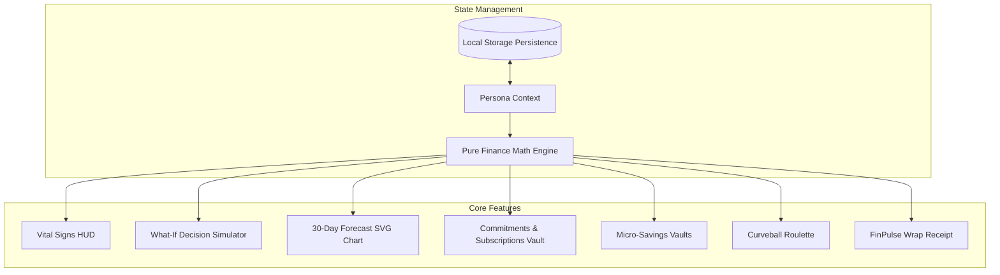

# ⚡ PULSE // Gen Z ₹10k 30-Day Financial OS & Decision Simulator

[](https://github.com/)
[](https://react.dev/)
[](https://tailwindcss.com/)
[](https://vitest.dev/)
[](LICENSE)
[](https://www.w3.org/WAI/standards-guidelines/wcag/)

> **A consumer-facing personal finance experience engineered for Gen Z managing a limited ₹10,000 budget over 30 days.**  
> Moving far beyond basic expense tracking, PULSE connects income, cashflow, commitments, savings goals, subscriptions, curveballs, and financial health into an **interconnected mathematical survival engine** featuring a real-time **"What-If" Decision Simulator**.

---

## 📑 Table of Contents

1. [Executive Summary & Problem Statement](#-executive-summary--problem-statement)
2. [Core Mathematical Architecture](#-core-mathematical-architecture)
3. [Key Modules & Feature Walkthrough](#-key-modules--feature-walkthrough)
4. [System Architecture Diagram](#-system-architecture-diagram)
5. [Tech Stack & Engineering Design](#-tech-stack--engineering-design)
6. [Getting Started & Local Setup](#-getting-started--local-setup)
7. [Automated Unit Test Suite](#-automated-unit-test-suite)
8. [Performance & Accessibility (WCAG 2.1 AA)](#-performance--accessibility-wcag-21-aa)
9. [Innovation & Gamification Highlights](#-innovation--gamification-highlights)
10. [Repository Structure](#-repository-structure)
11. [License & Contributing](#-license--contributing)

---

## 🎯 Executive Summary & Problem Statement

For young adults, college students, and entry-level interns in metropolitan hubs, living on a fixed **₹10,000 monthly allowance/stipend** is a high-stakes survival challenge. Basic finance trackers merely log expenses after the money is already gone. 

**PULSE solves this by introducing a Pre-Decision Sandbox**:
- Users can simulate financial purchases **before executing them**.
- Mathematical algorithms instantly calculate the ripple effect on daily discretionary leeway, upcoming rent obligations, savings milestones, and insolvency runways.
- Behavioral friction tools (such as the **48-Hour Wishlist Park**) prevent dopamine-driven impulse buys while rewarding discipline with gamified progression.

---

## 🧮 Core Mathematical Architecture

PULSE's financial logic is decoupled into a pure, deterministic engine (`src/utils/financeMath.js`):

### 1. Liquid Cash Balance
$$\text{Liquid Balance} = \sum \text{Incomes} - \sum \text{Expenses} - \sum \text{Funds Locked in Savings Vaults}$$
*When cash is deposited into a savings goal, it is sequestered from liquid spending, preventing accidental impulse spends.*

### 2. True Free Cash Flow
$$\text{True Free Cash} = \text{Liquid Balance} - (\text{Pending Commitments} + \text{Pending Active Subscriptions})$$

### 3. Safe Daily Allowance ("Safe to Spend Today")
$$\text{Safe Daily Spend} = \max\left(0, \left\lfloor \frac{\text{True Free Cash}}{\text{Days Remaining in Month}} \right\rfloor\right)$$
- If $\text{True Free Cash} \le 0$, allowance drops to **₹0/day** and triggers an insolvency deficit warning.

### 4. Financial Risk Index ($0\% - 100\%$)
$$R = R_{\text{base}} + \Delta R_{\text{liability}} + \Delta R_{\text{allowance}} + \Delta R_{\text{runway}} - \Delta R_{\text{emergency}}$$
- **Liability Stress**: Spikes if obligations exceed $50\%$ or $80\%$ of liquid cash.
- **Runway Deficit**: Adds penalty when runway days fall below remaining month days.
- **Emergency Shield**: Grants up to a $12\%$ reduction when emergency reserves exceed ₹1,200.

### 5. Financial Health Score ($0 - 100$)
$$H = 100 - (0.65 \times R) + \left(20 \times \frac{\text{Locked Savings}}{\text{Target Savings}}\right) - \text{Penalties}$$
- Categorized into Gen Z archetypes: **Zen Master** (82+), **Smart Hustler** (68-81), **Tightrope Walker** (50-67), and **Code Red Survivor** (<50).

---

## 🌟 Key Modules & Feature Walkthrough

### 1. Financial Vital Signs HUD
- **Liquid Cash Card**: Holographic fintech card with simulated microchip, live balance, and progress bar against the ₹10,000 budget cap.
- **Safe Daily Spend Hero Card**: Color-coded radial speedometer indicating real-time discretionary leeway.
- **Financial Health Radar**: Dynamic radial SVG gauge with solvency and discipline breakdowns.
- **Risk & Runway Horizon**: Stress meter tracking burn rate vs. the ₹333/day target.

### 2. The "What-If" Decision Simulator (Centerpiece Studio)
- **Presets & Sliders**: Instant 1-tap testing for temptations (Midnight Biryani, Sneaker Drop, Goa Trip, Artisanal Cafe) or custom amounts (₹50 to ₹5,000).
- **Before vs. After Matrix**: Live impact on liquid cash, daily allowance penalty (e.g. *-₹38/day*), risk surge, and health score impact.
- **FinPulse AI Terminal**: Realistic Gen Z advisor offering sharp roasts and practical alternatives.
- **Action Pathways**: Execute spend to debit real cash, or park in the **48-Hour Wishlist** to preserve funds with celebratory confetti.

### 3. 30-Day Trajectory Forecast Curve
- **High-Precision SVG Chart**: Plots Day 1 to Day 30 across baseline, current pacing, and simulated choice paths.
- **Insolvency Danger Shading**: Visualizes when budget hits ₹0 before month-end.
- **Interactive Day Scrubber**: Slider to inspect projected balances for any day.
- **Bill Milestone Pins**: Markers showing scheduled liability dates.

### 4. Commitments & Subscriptions Command Center
- **Fixed Bills**: PG/Mess rent, Wi-Fi, transit, and mobile recharge with due day badges (*Due in 2 days*, *Overdue*, *Cleared*).
- **Subscription Optimizer**: 1-tap toggles for Spotify, Netflix, gym passes, and AI tools. Pausing a subscription immediately frees up money and boosts daily allowance in real time.

### 5. Micro-Savings Vaults & Emergency Shield
- Dream pots for concert tickets, tech drops, and emergency buffers with battery-style progress bars.
- Locking cash protects goals from impulse spending; reaching ₹800+ in the Emergency Shield activates shock-absorption perks.

### 6. "Life Happens" Curveball Roulette
- Generates unpredictable real-world events: cracked phone screens (-₹1,250), surprise flatmate birthdays (-₹550), viral flu meds (-₹680), and lucky UPI cashbacks (+₹250).

### 7. FinPulse Wrapped (Innovation Feature)
- Generates a Spotify-Wrapped style receipt card summarizing spending habits, badges earned, wishlist savings, and overall financial grade.

---

## 📐 System Architecture Diagram



---

## 💻 Tech Stack & Engineering Design

- **Core Framework**: React 19.2.8
- **Styling**: Tailwind CSS v4.0 with Custom Glassmorphism Design System
- **Icons**: Lucide React
- **Celebratory FX**: Canvas Confetti
- **Audio Synthesis**: Native Web Audio API (zero audio file dependencies)
- **State Persistence**: Custom LocalStorage hook (`useLocalStorage.js`)
- **Testing**: Vitest 5.0.3
- **Bundler & Tooling**: Vite 8.3.4 with Rolldown / Oxc

---

## 🚀 Getting Started & Local Setup

### Prerequisites
- Node.js `v18.0.0` or higher
- npm `v9.0.0` or higher

### Installation
```bash
# 1. Clone the repository
git clone https://github.com/your-username/pulse-finance-os.git
cd pulse-finance-os

# 2. Install dependencies
npm install

# 3. Start development server
npm run dev

# 4. Open in browser
# Navigate to http://localhost:5173/
```

### Production Build
```bash
# Run production build
npm run build

# Preview production bundle
npm run preview
```

---

## 🧪 Automated Unit Test Suite

PULSE includes an automated unit test suite verifying mathematical formulas:

```bash
# Run test suite
npm test
```

### Test Coverage Summary
- `calculateLiquidBalance`: Correct initial ₹10k allocation & multi-item deductions.
- `calculatePendingCommitments`: Due date filtering & overdue bill aggregation.
- `calculatePendingSubscriptions`: Active/paused status filtering.
- `calculateSafeDailyAllowance`: Safe division, 0-bounds clamping, and negative free cash defense.
- `calculateRunwayDays`: Burn-rate pace tracking and 30-day clamping.
- `calculateFinancialRisk`: Liability pressure, allowance stress, and emergency fund cushion.
- `calculateFinancialHealth`: Normalized composite score bounds [10, 98].
- `calculateGamification`: Badge unlocks and level progression.

---

## ♿ Performance & Accessibility (WCAG 2.1 AA)

- **Semantic HTML**: Proper `<header>`, `<nav>`, `<main>`, `<section>`, and `<footer>` landmarks.
- **ARIA Standards**: `role="tablist"`, `role="tab"`, `aria-selected`, `role="dialog"`, `aria-modal="true"`, `role="status"`.
- **Keyboard Navigation**: Full tab index order, visible focus rings (`focus-visible:ring-2`), and Escape key dialog dismissal.
- **Skip Navigation**: Accessible `#main-content` skip link for screen readers.
- **Code-Splitting**: Route/tab modules split via `React.lazy` and `React.Suspense` with zero layout shift (`SkeletonLoader`).

---

## 🏆 Innovation & Gamification Highlights

1. **FinPulse Wrapped Receipt**: A 1-click summary card capturing the month's financial performance.
2. **Delayed Gratification Vault**: Tracks all impulse desires resisted, tallying exact rupees and daily allowance preserved.
3. **Emergency Shield Mechanics**: Gamifies savings by shielding the user's risk meter from random life shocks.
4. **Archetype Personas**: Pre-configured profiles (Hostel Hustler, Metro Intern, Solo Creator) reflecting genuine Gen Z life conditions.

---

## 📁 Repository Structure

```
pulse-finance-os/
├── public/                 # Static assets & favicons
├── src/
│   ├── components/         # Modular UI components
│   │   ├── AddTransactionModal.jsx   # Expense logging modal
│   │   ├── CommitmentsManager.jsx    # Bills & subscriptions vault
│   │   ├── CurveballRoulette.jsx     # Unexpected life events spinner
│   │   ├── DecisionSimulator.jsx     # What-If Decision Sandbox
│   │   ├── FinancialWrapModal.jsx    # FinPulse Wrap receipt modal
│   │   ├── ForecastChart.jsx         # 30-day interactive SVG chart
│   │   ├── Navbar.jsx                # Sticky header, persona & steppers
│   │   ├── OverviewDashboard.jsx     # Master fintech dashboard
│   │   ├── SavingsVaults.jsx         # Micro-savings vaults
│   │   ├── SkeletonLoader.jsx        # Suspense fallback skeleton
│   │   ├── TransactionLedger.jsx     # Filterable activity ledger
│   │   ├── VitalSignsHUD.jsx         # Heads-up display cards
│   │   └── WishlistVault.jsx         # Delayed gratification ledger
│   ├── context/
│   │   └── FinanceContext.jsx        # Central interconnected state
│   ├── data/
│   │   └── initialData.js            # Personas, presets & curveballs
│   ├── hooks/
│   │   └── useLocalStorage.js        # State synchronization hook
│   ├── utils/
│   │   ├── audio.js                  # Web Audio API sound synthesizer
│   │   ├── financeMath.js            # Pure mathematical formulas
│   │   └── financeMath.test.js       # Vitest unit test suite
│   ├── App.jsx                       # Root application shell
│   ├── index.css                     # Glassmorphism & design system
│   └── main.jsx                      # React 19 entry point
├── ARCHITECTURE.md         # Detailed architectural documentation
├── CHANGELOG.md            # Semantic version history
├── CONTRIBUTING.md         # Contribution guidelines
├── LICENSE                 # MIT License
├── SECURITY.md             # Security disclosures
├── package.json            # Scripts & dependencies
└── vite.config.js          # Vite & Rolldown configuration
```

---

## 📄 License & Contributing

Distributed under the **MIT License**. See [LICENSE](LICENSE) for details.  
Contributions, feature suggestions, and pull requests are welcomed! Please read [CONTRIBUTING.md](CONTRIBUTING.md) to get started.
